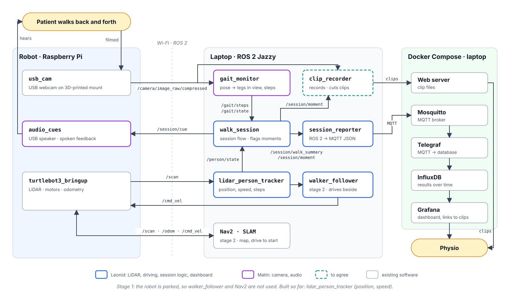

# Robot-Guided Home Rehabilitation

Monitoring and therapist feedback between physiotherapy sessions, using a TurtleBot3 Burger.

Group 105 project for the Prototyping and Fabrication course.

## Team

- Leonid Pomortsev: LiDAR, navigation, session logic, and dashboard
- Matin Mahmoudzadeh: camera, camera mast, step detection, and audio cues

## Presentations

| Presentation | Slides                                               |
| ------------ | ---------------------------------------------------- |
| Initial      | [presentation_initial.pdf](presentation_initial.pdf) |
| Mid-term     | [presentation_midterm.pdf](presentation_midterm.pdf) |
| Final        | To be added                                          |

## Problem

Gait rehabilitation depends on walking exercises that patients do at home, alone. Patients lose the rhythm, get tired, and stop early. The physiotherapist sees none of it, only what the patient remembers at the next appointment.

## Solution

A robot that films and watches the walking exercise at home, between appointments. It:

- **follows**: drives beside the patient, a little ahead, and keeps their legs in the camera picture;
- **measures**: steps per minute, walking speed and stops, with its LiDAR and the camera;
- **gives feedback**: speaks to the patient when they stop or slow down;
- **reports**: flags the moments that matter, cuts a short clip of each, and sends it to the physiotherapist's dashboard with the numbers that triggered it and a short note.

## Proof of concept

The proof of concept shows that a robot can film a walking exercise by itself, notice the moments that matter, and give the physiotherapist a short clip of each, with the numbers.

One healthy volunteer walks back and forth on a flat path of about 10 m. We build it in two stages:

1. **Parked**: the robot stands beside the walking path. It measures each walk, speaks to the person, flags moments, cuts the clips, and sends everything to the dashboard.
2. **Driving**: the robot drives beside the person, a little ahead, and keeps the legs in the picture during the whole walk.

Later, outside the proof of concept: heart rate from a chest strap, noticing a scream or a fall, and a beat to walk to.

### Evaluation

- **Step accuracy**: steps per minute compared with a manual step count, for the LiDAR and the camera. First goal: within ±5%.
- **Flagged moments**: in walks with planned stops and slow parts, how many are flagged, missed, or flagged wrongly.
- **Framing** (stage 2): how much of the walking time both legs are fully in the picture.
- **Reaction time**: how quickly the robot notices that the person has stopped, and speaks.

### Limitations

- Not a clinical device, and not tested with patients.
- Provides no physical support.
- Complements physiotherapy sessions and does not replace them.
- Tested on a flat lab floor only.

## Architecture



A webcam on the robot streams video to a laptop. The robot's LiDAR finds where the walker is and how fast they walk. The laptop counts the steps, runs the session logic, sends spoken feedback to a speaker on the robot, records the video, and cuts the clips of flagged moments. In stage 2 it also drives the robot beside the walker. Results and clips go to a Grafana dashboard over MQTT. See [docs/architecture.md](docs/architecture.md) for the components and interfaces, and [docs/decisions/](docs/decisions/) for the design decisions.

## Build and test

The ROS 2 packages are in [`ros2_ws/`](ros2_ws/) and need ROS 2 Jazzy on Ubuntu 24.04.

```bash
cd ros2_ws
colcon build --symlink-install
source install/setup.bash
colcon test && colcon test-result --verbose   # tests and lint
```

How to run each package, and the test steps for the real robot, are in the package READMEs: [`lidar_person_tracker`](ros2_ws/src/lidar_person_tracker/README.md). The offline video prototype has its own [README](walk_analysis_with_camera/README.md).

## Hardware

- TurtleBot3 Burger
- Additional equipment: see [required-equipment.md](required-equipment.md)

## Demo

To be added.

## Repository structure

```text
.
├── README.md                    # This page
├── required-equipment.md        # Hardware we use or borrow from the lab
├── presentation_initial.pdf     # Initial idea presentation
├── presentation_midterm.pdf     # Mid-term presentation
├── docs/
│   ├── architecture.md          # System architecture and interfaces
│   ├── decisions/               # Design decision records
│   └── img/                     # Diagrams
├── ros2_ws/src/
│   ├── gait_interfaces/         # Messages shared by our nodes
│   └── lidar_person_tracker/    # Finds the walker in the LiDAR scan
└── walk_analysis_with_camera/   # Gait and cadence analysis from video
```
