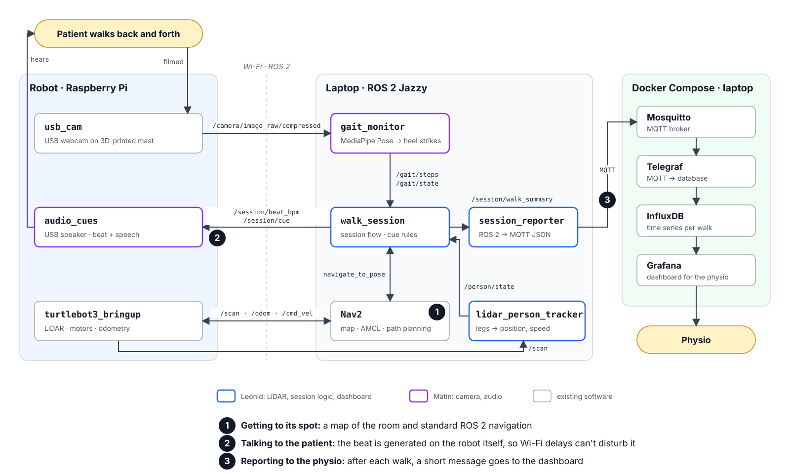

# Robot-Guided Home Rehabilitation

Monitoring and therapist feedback between physiotherapy sessions, using a TurtleBot3 Burger.

Group 105 project for the Prototyping and Fabrication course.

## Team

- Leonid Pomortsev: LiDAR, navigation, session logic, and dashboard
- Matin Mahmoudzadeh: camera, camera mast, step detection, and audio cues

## Presentations

| Presentation | Slides                                               |
| ------------ | ---------------------------------------------------- |
| Initial      | [presentation_initial.pdf](presentation_initial.pdf) |
| Mid-term     | To be added                                          |
| Final        | To be added                                          |

## Problem

Gait rehabilitation depends on walking exercises that patients do at home, alone. Patients lose their rhythm, drift into asymmetry as they tire, and cut sessions short. The physiotherapist sees none of it, only what the patient remembers at the next appointment.

## Solution

A robot that supervises the walking exercise between appointments. It:

- **guides**: positions itself beside the walking path and sets the rhythm of the walk with an audible beat;
- **measures**: times each step with a camera and pose estimation, and measures walking speed with the LiDAR. Together they give cadence, step length, and stops, and the LiDAR double-checks the camera's step count;
- **cues**: speaks a correction when the patient drifts off the rhythm or stops;
- **reports**: publishes a session summary to a dashboard the physiotherapist can act on.

## Proof of concept

A TurtleBot3 that drives itself to a station beside a walking path and stays still while a person walks back and forth past it. During the session it plays a beat at the target cadence, measures each lap, and speaks a correction when the person stops or drifts off the beat. After each lap it sends a summary to the physiotherapist's dashboard.

- One healthy volunteer, one walking exercise, on a flat walking path of about 10 m.
- Capture zone of about 3–4 m, set by the camera's field of view.
- Stretch goals: step-time symmetry, and rotating in place to keep the walker in view.

### Evaluation

- **Detection latency**: how quickly the robot notices that the person has stopped.
- **Measurement accuracy**: measured cadence compared with a manual step count.
- **Cue reliability**: whether the right cue fires, across repeated walks.

### Limitations

- Not a clinical device, and not tested with patients.
- Provides no physical support.
- Complements physiotherapy sessions and does not replace them.

## Architecture



A webcam on the robot streams video to a laptop, which detects steps with pose estimation. The robot's LiDAR tracks where the walker is and how fast they walk. The laptop runs the session logic and sends the beat and spoken cues back to a speaker on the robot. Session summaries go over MQTT to a Grafana dashboard. See [docs/architecture.md](docs/architecture.md) for the components and interfaces, and [docs/decisions/](docs/decisions/) for the design decisions.

## Hardware

- TurtleBot3 Burger
- Additional equipment: see [required-equipment.md](required-equipment.md)

## Demo

To be added.

## Repository structure

```text
.
├── README.md                    # This page
├── required-equipment.md        # Hardware we use or borrow from the lab
├── presentation_initial.pdf     # Initial idea presentation
├── docs/
│   ├── architecture.md          # System architecture and interfaces
│   ├── decisions/               # Design decision records
│   └── img/                     # Diagrams
└── walk_analysis_with_camera/   # Gait and cadence analysis from video
```
