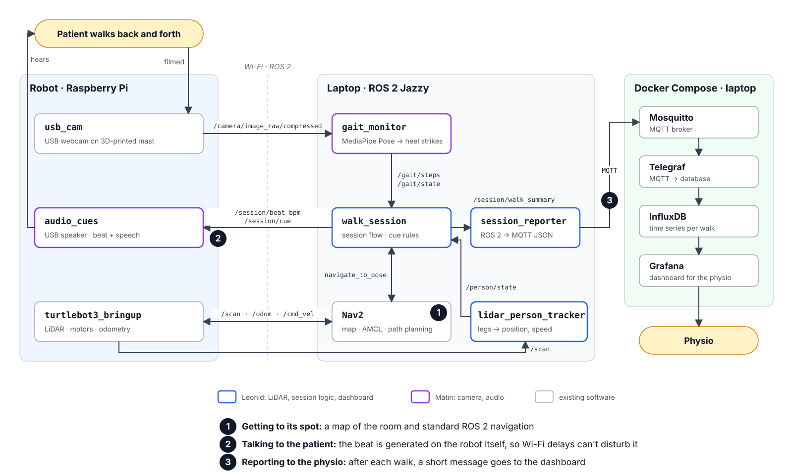
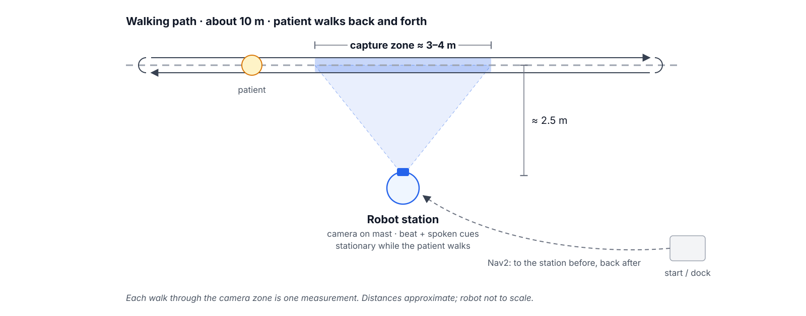

# Architecture

Status: target design for the final proof of concept, as presented at the mid-term. Only the offline gait prototype in [`walk_analysis_with_camera/`](../walk_analysis_with_camera/) exists so far. Decisions are recorded in [`decisions/`](decisions/).

## Overview

The robot measures walking from a spot it reaches by itself. Before a session it drives to a spot beside a walking path and points its camera across the walking path. The patient walks back and forth past the robot, through the camera zone, while the robot plays a beat at the prescribed cadence. A laptop on the same network turns the video into gait metrics, decides on spoken cues, and sends a summary of each walk to a dashboard for the physiotherapist. In this document, a *walk* means one walk past the robot through the camera zone; each walk is one measurement.

## Physical setup

- Flat walking path, about 10 m long, with room for the robot about 2.5 m to the side (lab floor or a wide hallway).
- Robot parked about 2.5 m from the walking line, camera on a 3D-printed mast at about knee height, looking across the path.
- Camera zone: the part of the walking line inside the camera's view, about 3–4 m depending on camera and distance.
- The robot does not move while anyone is walking in the zone ([ADR 2](decisions/0002-robot-parks-beside-path.md)).

## Session flow

1. **Position**: the robot drives to its spot (a pose on a map built beforehand with SLAM), using Nav2 `NavigateToPose`.
2. **Wait**: the robot says it is ready and starts the beat at the target cadence once a person is in view.
3. **Walk**: the patient walks through the zone. The camera counts steps; the LiDAR tracks where the person is and how fast they move, and decides when the camera's steps count.
4. **Between walks**: the robot gives a cue or the walk count, based on the last walk.
5. **Finish**: after the prescribed number of walks, the session summary is published and the robot returns to its start pose.

## Components

### Robot (TurtleBot3 Burger, Raspberry Pi)

| Component | Package | Role |
| --- | --- | --- |
| Robot drivers | `turtlebot3_bringup` (existing) | `/scan`, `/odom`, `/cmd_vel`, TF |
| Camera driver | `usb_cam` (existing) | Publishes compressed frames from the USB webcam |
| Audio player | `audio_cues` (ours) | Plays the beat locally at the target tempo; speaks cue texts with offline text-to-speech ([ADR 3](decisions/0003-what-runs-on-robot-and-laptop.md)) |

### Laptop (ROS 2 Jazzy, same `ROS_DOMAIN_ID`)

| Component | Package | Role |
| --- | --- | --- |
| Gait monitor | `gait_monitor` (ours) | Pose estimation per frame; a step is the moment the feet are furthest apart. Reuses `walk_analysis` ([ADR 1](decisions/0001-how-we-measure-walking.md), [ADR 3](decisions/0003-what-runs-on-robot-and-laptop.md)) |
| LiDAR person tracker | `lidar_person_tracker` (ours) | Finds the walker's legs in the scan: presence, position along the path, walking speed; a rough step count for the accuracy comparison |
| Session manager | `walk_session` (ours) | State machine for the session flow; counts camera steps only when the LiDAR says the person is walking through the middle of the zone; cue rules, walk summaries, Nav2 goals |
| Navigation | `turtlebot3_navigation2` (existing) | Map, AMCL localisation, path to the spot and back |
| MQTT bridge | `session_reporter` (ours) | Converts walk and session summaries to JSON on MQTT |
| Dashboard stack | Docker Compose | Mosquitto, Telegraf, InfluxDB, Grafana ([ADR 4](decisions/0004-mqtt-and-grafana-dashboard.md)) |

Custom message types live in a separate `gait_interfaces` package.

## ROS 2 interfaces

| Topic / action | Type | From → to | Content |
| --- | --- | --- | --- |
| `/camera/image_raw/compressed` | `sensor_msgs/CompressedImage` | `usb_cam` → `gait_monitor` | MJPEG frames, camera timestamps |
| `/gait/steps` | `gait_interfaces/StepEvent` | `gait_monitor` → `walk_session` | Time, foot (left/right) and confidence of each detected step |
| `/gait/state` | `gait_interfaces/GaitState` | `gait_monitor` → `walk_session` | Person in view, rolling cadence (steps/min), time since last step |
| `/scan` | `sensor_msgs/LaserScan` | `turtlebot3_bringup` → `lidar_person_tracker`, Nav2 | LiDAR ranges |
| `/person/state` | `gait_interfaces/PersonState` | `lidar_person_tracker` → `walk_session` | Person detected, number of people, position along the path, walking speed, rough step count |
| `/session/beat_bpm` | `std_msgs/Float32` | `walk_session` → `audio_cues` | Beat tempo; 0 stops the beat |
| `/session/cue` | `std_msgs/String` | `walk_session` → `audio_cues` | Text to speak |
| `/session/walk_summary` | `gait_interfaces/WalkSummary` | `walk_session` → `session_reporter` | Per walk: measured or not, duration, counted steps, mean cadence, stops, average speed |
| `navigate_to_pose` | `nav2_msgs/action/NavigateToPose` | `walk_session` → Nav2 | Spot pose and return pose |

## MQTT interface

Broker: Mosquitto on the laptop, port 1883, local network only. Payloads are JSON.

| MQTT topic | When | Payload fields |
| --- | --- | --- |
| `rehab/<patient_id>/walk` | After each walk | `session_id`, `walk`, `duration_s`, `steps`, `measured`, `cadence_spm`, `target_spm`, `stops`, `speed_mps` |
| `rehab/<patient_id>/session` | End of session | `session_id`, `walks`, `mean_cadence_spm`, `cadence_drift_spm` (last walk minus first), `total_stops` |

`patient_id` is an anonymised ID, never a name.

## Gait metrics

Cadence is the main measurement: it drives the corrections during the walk and the physiotherapist's summary. The camera counts the steps and the LiDAR decides when the count can be trusted ([ADR 1](decisions/0001-how-we-measure-walking.md)).

| Situation (from the LiDAR) | Camera steps |
| --- | --- |
| Walking through the middle of the zone | Counted |
| Turning at the end of the zone | Ignored |
| Standing, shifting weight | Ignored; a stop if it lasts N seconds |
| Entering or leaving the view | Ignored |
| Person not found, or two people | Walk not measured |

| Metric | Sensor | Method | Used during the walk | In the summary |
| --- | --- | --- | --- | --- |
| Steps | Camera | Moment the feet are furthest apart (front heel lands), divided by shin length; must alternate left/right at a plausible interval | — | Count per walk |
| Cadence | Camera, LiDAR gate | Counted steps per minute, over the last few seconds and per walk | Compared with the beat → cue | Per walk; first vs last walk (fatigue) |
| Stop | Both | No step from the camera and no movement from the LiDAR for N seconds | Cue | Count and time |
| Walking speed | LiDAR | Slope of a line fitted to the walker's position over the last second | — | Per walk |

**Accuracy.** First goal: cadence within ±5% of a hand count, adjusted after the first recordings. The same walks are compared with the hand count three ways: camera alone, LiDAR alone, both together. The current prototype in [`walk_analysis.cadence`](../walk_analysis_with_camera/src/walk_analysis/cadence.py) detects steps from ankle lift and serves as a baseline. N, the plausible step interval and the cadence band are set from the recordings, not chosen in advance.

## Cue rules

| Condition | Spoken cue |
| --- | --- |
| Person in view, not yet walking | "Ready when you are" |
| Stop detected during a walk | "Take your time, start again when ready" |
| Walk cadence below target band | "Try to step with the beat" |
| Walk cadence above target band | "A little slower" |
| Walk within the band | Walk count and encouragement |
| Walk not measured | Walk count only, no correction |
| Camera stream lost | "Pausing, please wait" (session paused) |

The target cadence, tolerance band, number of walks and spot pose come from a session parameter file set by the physiotherapist.

## Ownership

The work is split by sensor so that both team members can work independently. The `gait_interfaces` messages and the topics above are the contract between the two parts; change them only together.

| Part | Owner | Packages |
| --- | --- | --- |
| LiDAR, robot and session logic | Leonid Pomortsev | `lidar_person_tracker`, `walk_session`, Nav2 setup and map, `session_reporter`, dashboard stack |
| Camera and audio | Matin Mahmoudzadeh | camera mast, `usb_cam` setup, `gait_monitor`, `audio_cues` |

## Safety and privacy

- The robot moves only before and after the session, with the default TurtleBot3 speed limits and Nav2 obstacle avoidance. It is stationary while a person walks.
- The robot gives no physical support and is not a clinical device.
- Video frames are processed in memory and never stored. Only metrics are sent over MQTT, tagged with an anonymised ID.
- If the camera stream or pose tracking drops, the session pauses rather than reporting wrong metrics.

## Stretch goals

- Rotate in place to keep the walker in frame and lengthen the camera zone.
- Step-time symmetry per walk.
- Step length (walking speed ÷ steps per second).
- Session start/stop button on an ESP32, over MQTT.
