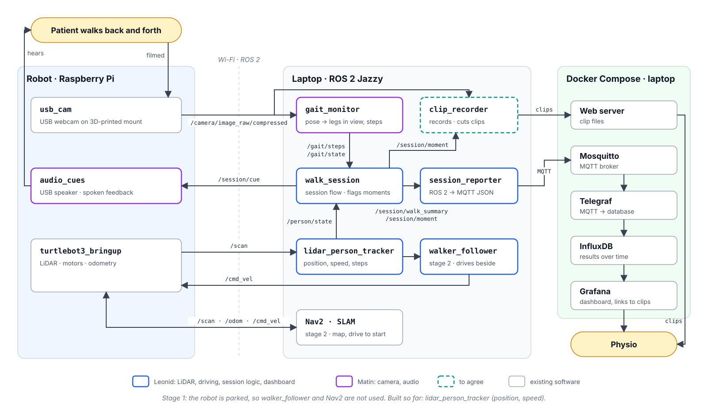
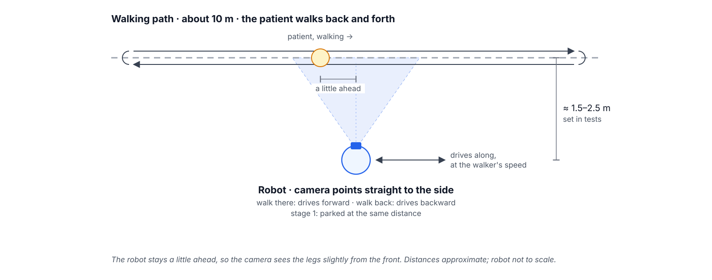

# Architecture

Status: target design for the final proof of concept, revised on 2026-11-19 after a project session with the professors. Built so far, in [`ros2_ws/`](../ros2_ws/) and [`dashboard/`](../dashboard/): the LiDAR person tracker (position, speed and steps of the walker; for a driving robot tested on one recording, with a known problem, see [ADR 5](decisions/0005-follow-the-walker-with-the-odometry.md)), and a first session loop with the LiDAR only (walks, stops, the spoken stop cue, and each walk's numbers on the dashboard), which can be watched in RViz. Also the offline camera prototype in [`walk_analysis_with_camera/`](../walk_analysis_with_camera/). Everything else is planned. Decisions are recorded in [`decisions/`](decisions/).

## Overview

The robot films a walking exercise and keeps the camera on the patient's legs. It measures the walk with its LiDAR and the camera, speaks to the patient when something goes wrong, and flags the moments that matter. For each flagged moment, the physiotherapist gets a short clip, the numbers that triggered it, and a short note. A laptop on the same network does the processing.

The patient walks back and forth on a flat path of about 10 m. In this document, a *walk* is one way along the path, from one turn to the next.

The robot gives two outputs:

| For | What | When |
| --- | --- | --- |
| Patient | Spoken feedback from the robot's speaker | During the walk |
| Physiotherapist | Numbers per walk and per session, and for each flagged moment a clip with its numbers and a note, on a dashboard | After each walk and each session |

## Stages

| Stage | Robot |
| --- | --- |
| 1 | Parked beside the path. Measuring, feedback, flagged moments, clips and the dashboard are built and tested on a robot that does not move. |
| 2 | Drives beside the person, a little ahead, keeping the legs in the picture ([ADR 1](decisions/0001-robot-drives-beside-the-walker.md)) |
| Later | Not in the proof of concept: driving to the start of the path by itself, heart rate from a chest strap, noticing a scream or a fall, a beat to walk to |

## Physical setup

- Flat walking path, about 10 m long, with room beside it for the robot (lab floor or a wide hallway).
- Camera on a 3D-printed mount at about knee height, pointing straight to the side.
- Stage 1: the robot is parked about 1.5–2.5 m from the walking line. The camera sees 3–4 m of the path.
- Stage 2: the robot drives parallel to the path, at about the same distance, a little ahead of the person, so the camera sees the legs slightly from the front. It drives forward on one walk and backward on the walk back, so the camera stays on the person's side. While the person turns around, the robot moves a short way, to be a little ahead again.
- The distances are set from tests.

## Session flow

1. **Start**: the robot is placed at the start of the path by hand. Driving there by itself, with Nav2 on a SLAM map, comes later. With the robot parked, the tracker learns the scan of the empty room for about 2 seconds; the path must be clear during that time.
2. **Walks**: the patient walks back and forth. The robot records the video, measures each walk, and speaks when the patient stops or slows down. In stage 2 it drives along. How a walk's start, end and stops are noticed: [`walk_session`](../ros2_ws/src/walk_session/README.md#walks-and-stops). With the robot parked, a walk is the part of one way that the LiDAR sees, about 5 m.
3. **Flagged moment**: when a rule below fires, the moment is saved with its time and numbers, and a clip from a few seconds before to a few seconds after is cut from the recording.
4. **End**: after the set number of walks, the session summary and the flagged moments go to the dashboard.

## Components

### Robot (TurtleBot3 Burger, Raspberry Pi)

| Component | Package | Role |
| --- | --- | --- |
| Robot drivers | `turtlebot3_bringup` (existing) | `/scan`, `/odom`, `/cmd_vel`, TF |
| Camera driver | `usb_cam` (existing) | Compressed frames from the USB webcam |
| Audio | `audio_cues` (ours, planned) | Speaks the feedback texts with offline text-to-speech ([ADR 2](decisions/0002-what-runs-on-robot-and-laptop.md)) |

### Laptop (ROS 2 Jazzy, same `ROS_DOMAIN_ID`)

| Component | Package | Role |
| --- | --- | --- |
| LiDAR person tracker | `lidar_person_tracker` (ours, built) | Number of people, position along the path, walking speed, steps. Two modes, chosen by hand: static, robot parked, compares each scan with the empty room ([ADR 4](decisions/0004-find-the-walker-against-the-empty-room.md)); driving, follows the walker's points from scan to scan with the odometry ([ADR 5](decisions/0005-follow-the-walker-with-the-odometry.md)); in its first recording, the track moved from the walker onto the room |
| Gait monitor | `gait_monitor` (ours, planned) | Pose estimation per frame: are the legs in the picture, and steps from the video as a second opinion. Reuses `walk_analysis` |
| Session manager | `walk_session` (ours, built with the LiDAR only) | Session flow, feedback rules, flagged moments, walk summaries. Built: walks, stops, the stop cue, walk summaries, and a view of the session in RViz |
| Cue speaker | `walk_session` (ours, built, stand-in) | Speaks the cues on the laptop until `audio_cues` speaks them on the robot |
| Clip recorder | `clip_recorder` (ours, planned) | Records the camera stream during the session and cuts a clip for each flagged moment |
| Walker follower | `walker_follower` (ours, planned, stage 2) | Drives beside the walker: matches their speed, keeps the gap and the side distance, stops when the walker is lost |
| Navigation | `turtlebot3_navigation2`, SLAM (existing, later) | Map of the room, driving to the start of the path |
| MQTT bridge | `session_reporter` (ours, built for walks) | Walk, moment and session summaries as JSON on MQTT |
| Dashboard stack | Docker Compose in [`dashboard/`](../dashboard/) (built; clip web server planned) | Mosquitto, Telegraf, InfluxDB, Grafana, and a web server for the clips ([ADR 3](decisions/0003-mqtt-and-grafana-dashboard.md)) |

Our message types live in the `gait_interfaces` package.

## ROS 2 interfaces

Built: `/scan`, `/odom`, `/person/state`, the relearn service, `/session/walk_summary`, `/session/cue`, and the markers, panels and `walking_path` frame for RViz. The rest is planned; the topics marked *to agree* connect to Matin's part and are agreed with him first.

| Topic / action | Type | From → to | Content |
| --- | --- | --- | --- |
| `/scan` | `sensor_msgs/LaserScan` | `turtlebot3_bringup` → `lidar_person_tracker`, Nav2 | LiDAR distances |
| `/odom` | `nav_msgs/Odometry` | `turtlebot3_bringup` → `lidar_person_tracker`, `walker_follower` | Where the robot is, from its wheel turns |
| `/person/state` | `gait_interfaces/PersonState` | `lidar_person_tracker` → `walk_session`, `walker_follower` | Person detected, number of people, position along the path from the robot, walking speed over the floor, steps |
| `/lidar_person_tracker/relearn_background` | `std_srvs/srv/Trigger` | `walk_session` → `lidar_person_tracker` | Learn the empty room again; called after the robot has parked |
| `/camera/image_raw/compressed` | `sensor_msgs/CompressedImage` | `usb_cam` → `gait_monitor`, `clip_recorder` | MJPEG frames, camera timestamps |
| `/gait/steps` | `gait_interfaces/StepEvent` | `gait_monitor` → `walk_session` | *To agree*: time and confidence of each step seen by the camera |
| `/gait/state` | `gait_interfaces/GaitState` | `gait_monitor` → `walk_session` | *To agree*: legs in the picture, steps per minute |
| `/session/moment` | `gait_interfaces/Moment` | `walk_session` → `clip_recorder`, `session_reporter` | Time, what happened, the numbers, the note |
| `/session/walk_summary` | `gait_interfaces/WalkSummary` | `walk_session` → `session_reporter` | Per walk: measured or not, duration, steps, steps per minute, stops, speed |
| `/session/cue` | `std_msgs/String` | `walk_session` → `audio_cues`; for now the stand-in `cue_speaker` | *To agree*: text to speak |
| `/lidar_person_tracker/markers` | `visualization_msgs/MarkerArray` | `lidar_person_tracker` → RViz | The watched strip and the walker's points, to watch a session |
| `/lidar_person_tracker/panel`, `/walk_session/panel` | `rviz_2d_overlay_msgs/OverlayText` | `lidar_person_tracker`, `walk_session` → RViz | Text panels: what the tracker sees, and the walk in progress |
| `/tf_static`: `base_scan` → `walking_path` | `tf2_msgs/TFMessage` | `lidar_person_tracker` → RViz | The LiDAR's frame turned so that x runs along the path, for drawing |
| `/cmd_vel` | `geometry_msgs/TwistStamped` | `walker_follower` → `turtlebot3_bringup` | Speed commands while following (stage 2) |
| `navigate_to_pose` | `nav2_msgs/action/NavigateToPose` | `walk_session` → Nav2 | Start of the path, and back (later) |

## MQTT interface

Broker: Mosquitto on the laptop, port 1883, local network only. Payloads are JSON.

| MQTT topic | When | Payload fields |
| --- | --- | --- |
| `rehab/<patient_id>/walk` | After each walk | `session_id`, `walk`, `duration_s`, `measured`, `steps`, `cadence_spm`, `speed_mps`, `stops` |
| `rehab/<patient_id>/moment` | At each flagged moment | `session_id`, `walk`, `time`, `kind`, `values`, `note`, `clip` (file name) |
| `rehab/<patient_id>/session` | End of session | `session_id`, `walks`, `mean_cadence_spm`, `cadence_drift_spm` (last walk minus first), `total_stops`, `moments` |

Built: the walk messages. Each walk is stored at the time it reaches the broker, on the laptop's clock. `patient_id` is an anonymised ID, never a name.

## Measurements

| Measurement | Sensor | How | Status |
| --- | --- | --- | --- |
| Position along the path | LiDAR, odometry while driving | Parked: points nearer than the empty room, inside the watched strip ([ADR 4](decisions/0004-find-the-walker-against-the-empty-room.md)). Driving: the points near where the walker should be, in the odom frame ([ADR 5](decisions/0005-follow-the-walker-with-the-odometry.md)) | Built, stage 1; driving: one recording, known problem ([ADR 5](decisions/0005-follow-the-walker-with-the-odometry.md)) |
| Walking speed | LiDAR, odometry while driving | Slope of a line fitted to the positions of the last second, over the floor | Built, stage 1; driving: one recording, known problem |
| Steps, steps per minute | LiDAR; camera as a second opinion | LiDAR: each time the person's points spread out (feet apart) and close up again (legs passing), while the person moves on along the path ([ADR 4](decisions/0004-find-the-walker-against-the-empty-room.md)). Camera: the moment the feet are furthest apart | Built (LiDAR), stage 1; camera planned |
| Stop | LiDAR, camera | During a walk, slower than 0.15 m/s and no new step for 3 s | Built (LiDAR), stage 1 |

The LiDAR counts the steps: in the replays of the first recordings, each step is visible in the scan, so the step count does not have to wait for the camera. The camera count is a second opinion. Both are checked against a hand count on the same walks. First goal: steps per minute within ±5% of the hand count.

Walking speed does not come from the steps: it is how fast the position changes. Steps give the rhythm (steps per minute) and the stops. Together, speed and steps give the step length (see Later). The camera prototype in [`walk_analysis.cadence`](../walk_analysis_with_camera/src/walk_analysis/cadence.py) detects steps from ankle lift and serves as a baseline.

## Flagged moments and feedback

| What happens | How it is noticed | Spoken feedback to the patient |
| --- | --- | --- |
| Stops during a walk for more than N seconds | No movement and no steps | "Take your time, start again when ready" |
| Steps slower than the target | Steps per minute over the last few seconds | "Try to keep your pace" |
| Steps uneven | Big differences between the times of one step and the next | None |
| Walks much slower than at the start of the session | LiDAR speed, compared with the first walks | None |
| Person lost, or two people on the path | LiDAR | None; the walk is marked as not measured |

Other spoken feedback: "Ready when you are" when the person is on the path and has not started yet, and the walk count after each walk.

Each flagged moment gives the physiotherapist:

- a clip, from a few seconds before to a few seconds after the moment;
- the numbers that triggered it, for example the steps per minute before and during the moment;
- a short note made from a template, for example: "Walk 3, 01:42: stopped for 6 s. Steps per minute before the stop: 96, target 100."

N, the target and the other limits come from a session parameter file set by the physiotherapist. Their starting values are set from recordings, not chosen in advance.

## Ownership

The work is split by sensor so that both team members can work independently. The `gait_interfaces` messages and the topics above are the contract between the two parts; change them only together. The split of the new parts (clips, driving) is still to be agreed with Matin.

| Part | Owner | Packages |
| --- | --- | --- |
| LiDAR, driving, session logic and dashboard | Leonid Pomortsev | `lidar_person_tracker`, `walker_follower`, `walk_session`, Nav2 setup and map, `session_reporter`, dashboard stack |
| Camera and audio | Matin Mahmoudzadeh | camera mount, `usb_cam` setup, `gait_monitor`, `audio_cues` |
| To agree | | `clip_recorder` |

## Safety

- The robot drives only beside the walking path, never in the walking line, and keeps its distance to the person.
- The TurtleBot3 speed limits are not raised without a separate decision. Once Nav2 is added, it avoids obstacles on the way to the start of the path.
- The robot stops when it loses the person, sees two people, or when anything comes closer than a safety distance, to be set in tests. While driving, the tracker cannot tell a second person right next to the walker apart ([ADR 5](decisions/0005-follow-the-walker-with-the-odometry.md)); the safety distance has to cover that.
- The TurtleBot3 driver keeps the last speed command when commands stop arriving: it has no timeout. Checked in its code and on the real robot on 2026-11-27, when a stop sent from the laptop got lost over Wi-Fi and the robot drove on. A stop sent over Wi-Fi is therefore not enough: a check on the robot itself has to stop it when the follower's commands stop arriving.
- The robot gives no physical support and is not a clinical device.
- Video stays on the laptop, on the local network. Messages carry an anonymised ID, never a name.

## Later

- Driving to the start of the path by itself, with Nav2 on a SLAM map.
- Heart rate from a chest strap, as one more reason to flag a moment.
- Noticing a scream (microphone) or a fall (LiDAR).
- A beat to walk to.
- Step length (walking speed ÷ steps per second).
- Session start and stop button on an ESP32, over MQTT.
